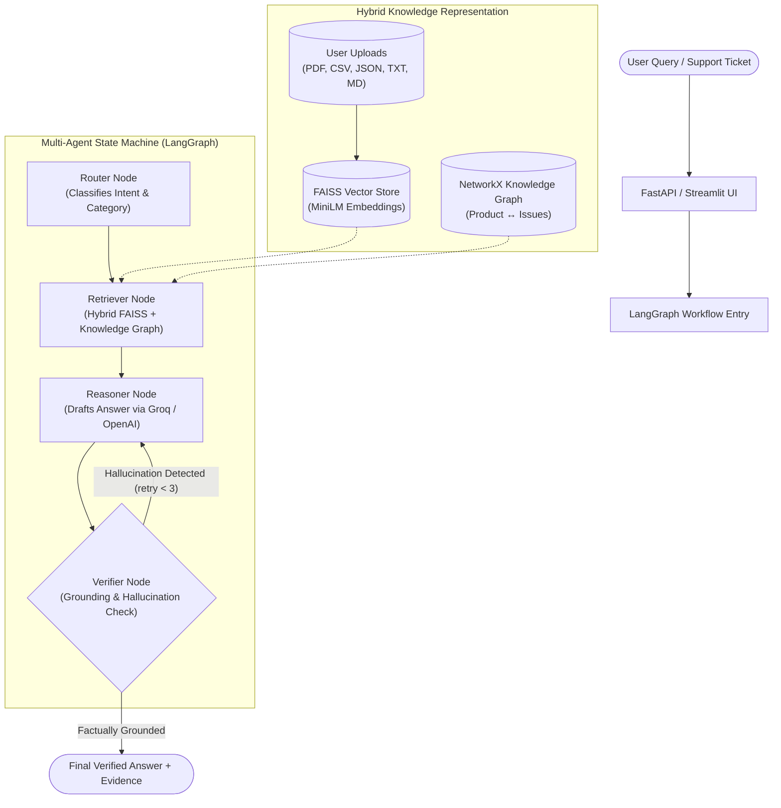

# SupportGPT — Agentic RAG System for Customer Support

[](https://github.com/rjunereddy/supportgpt/actions/workflows/ci.yml)
[](https://fastapi.tiangolo.com)
[](https://langchain-ai.github.io/langgraph/)
[](https://streamlit.io)
[](LICENSE)

An enterprise-grade, multi-agent Retrieval-Augmented Generation (RAG) assistant designed for technical customer support. SupportGPT reproduces core mechanics of **Self-RAG (Asai et al., 2023)** to eliminate hallucinations through cyclical self-reflection, combines **dense vector search (FAISS)** with a **structured Knowledge Graph (NetworkX)**, supports dynamic document uploads, and provides dual-engine LLM reasoning across **Groq LPUs** and **OpenAI GPT models**.

---

## 🌟 Key Features

- **Multi-Agent State Machine**: Router, Retriever, Reasoner, and Verifier nodes orchestrated cyclically via **LangGraph**.
- **Self-RAG Hallucination Elimination**: Automated claim verification loops back to the Reasoner with critique guidance if answers lack grounding.
- **Hybrid Retrieval**:
  - **Dense Vector Search**: Powered by `sentence-transformers/all-MiniLM-L6-v2` and FAISS.
  - **Explicit Knowledge Graph**: NetworkX graph linking `Product ↔ Category ↔ Known Issues ↔ Resolutions`.
- **Dynamic Document Ingestion**: Ingest `.pdf`, `.csv`, `.json`, `.txt`, and `.md` files dynamically with automatic chunking and source attribution.
- **Dual LLM Provider Support**:
  - **Groq LPUs**: Sub-second responses powered by `llama-3.1-8b-instant`, `llama-3.1-70b-versatile`, `mixtral-8x7b-32768`.
  - **OpenAI**: Frontier reasoning using `gpt-4o-mini`, `gpt-4o`, `gpt-3.5-turbo`.
- **Interactive Streamlit Web UI**: Real-time chat, source attribution viewer, thought process inspection, file uploader, and live key configuration.
- **Production-Ready FastAPI Microservice**: Fully documented REST API (`/query`, `/upload`, `/stats`, `/config/keys`, `/reset-index`) with Swagger docs at `/docs`.
- **Containerized Deployment**: Ready-to-deploy multi-container setup via Docker Compose.

---

## 🏗️ Architecture



---

## 📁 Repository Structure

```text
SupportGPT/
├── agents/             # Multi-agent LangGraph workflow
│   ├── orchestrator.py # StateGraph definitions and conditional edges
│   ├── router.py       # Query intent classification
│   ├── retriever.py    # Dual retrieval (FAISS + NetworkX Knowledge Graph)
│   ├── reasoner.py     # LLM inference engine (Groq / OpenAI / Mock)
│   └── verifier.py     # Hallucination and factual grounding verifier
├── api/                # FastAPI application and route definitions
│   └── main.py         # REST endpoints for query, upload, stats, and keys
├── config/             # Configuration & environment management
│   └── settings.py     # Dynamic key reloading and persistence
├── data/               # Raw and processed datasets
│   ├── raw/            # Baseline support ticket corpus
│   ├── processed/      # FAISS vector index and manifest
│   └── uploads/        # Uploaded user documents
├── graph/              # Knowledge Graph builders
│   └── builder.py      # NetworkX support graph builder
├── models/             # Representation learning & fine-tuning
│   └── train_intent.py # PEFT/LoRA fine-tuning for DistilBERT
├── retrieval/          # Search & dynamic ingestion engine
│   └── vector_store.py # Multi-format document parser & FAISS manager
├── scripts/            # Utilities and testing scripts
│   ├── generate_data.py# Generates baseline ticket dataset
│   └── verify.py       # End-to-end multi-agent cycle test
├── tests/              # Pytest automated test suite
│   └── test_api.py     # FastAPI test client suite
├── ui/                 # Streamlit frontend dashboard
│   └── app.py          # Interactive web UI
├── docker-compose.yml  # Docker Compose orchestration
├── Dockerfile          # Container build definition
├── Makefile            # Convenience commands
└── requirements.txt    # Project dependencies
```

---

## 🚀 Getting Started

### 1. Clone & Set Up Virtual Environment

```bash
git clone https://github.com/rjunereddy/supportgpt.git
cd supportgpt

# Create virtual environment
python -m venv venv

# Activate virtual environment
# Windows PowerShell:
.\venv\Scripts\Activate.ps1
# Linux / macOS:
source venv/bin/activate

# Install dependencies
pip install -r requirements.txt
```

### 2. Configure Environment Variables

Copy the example environment file:
```bash
cp .env.example .env
```
Edit `.env` to add your API keys:
```env
OPENAI_API_KEY=your_openai_api_key_here
GROQ_API_KEY=your_groq_api_key_here
```
*(If no keys are provided or kept as `mock`, the application will run in simulated Mock LLM mode).*

### 3. Build Knowledge Base & Vector Index

```bash
# Set PYTHONPATH to project root
# Windows PowerShell:
$env:PYTHONPATH = "."
# Linux / macOS:
export PYTHONPATH=.

# Generate baseline dataset and build FAISS index
python scripts/generate_data.py
python retrieval/vector_store.py
```

### 4. Run the Backend API

```bash
uvicorn api.main:app --reload --port 8000
```
- API is running at: [http://localhost:8000](http://localhost:8000)
- Interactive Swagger docs: [http://localhost:8000/docs](http://localhost:8000/docs)

### 5. Run the Streamlit Web Interface

In a second terminal window:
```bash
streamlit run ui/app.py
```
- Web UI will open at: [http://localhost:8501](http://localhost:8501)

---

## 🐳 Docker Deployment

To build and run both the API and Streamlit UI in isolated containers:

```bash
docker-compose up --build
```

- **Streamlit Web UI**: [http://localhost:8501](http://localhost:8501)
- **FastAPI Backend**: [http://localhost:8000](http://localhost:8000)
- **API Documentation**: [http://localhost:8000/docs](http://localhost:8000/docs)

To stop the containers:
```bash
docker-compose down
```

---

## 🧪 Testing & Verification

Run the multi-agent graph verification script:
```bash
python scripts/verify.py
```

Run the automated Pytest suite:
```bash
pytest tests/
```

---

## 📡 API Endpoints Reference

| Method | Endpoint | Description |
| :--- | :--- | :--- |
| `GET` | `/` | Health check & provider status |
| `GET` | `/stats` | Knowledge base chunk count & indexed files |
| `POST` | `/query` | Runs multi-agent LangGraph RAG inquiry |
| `POST` | `/upload` | Upload & index documents (`.pdf`, `.csv`, `.json`, `.txt`, `.md`) |
| `POST` | `/config/keys` | Update API keys dynamically |
| `POST` | `/reset-index`| Resets knowledge base to baseline dataset |

---

## 📄 License

This project is licensed under the MIT License - see the [LICENSE](LICENSE) file for details.
